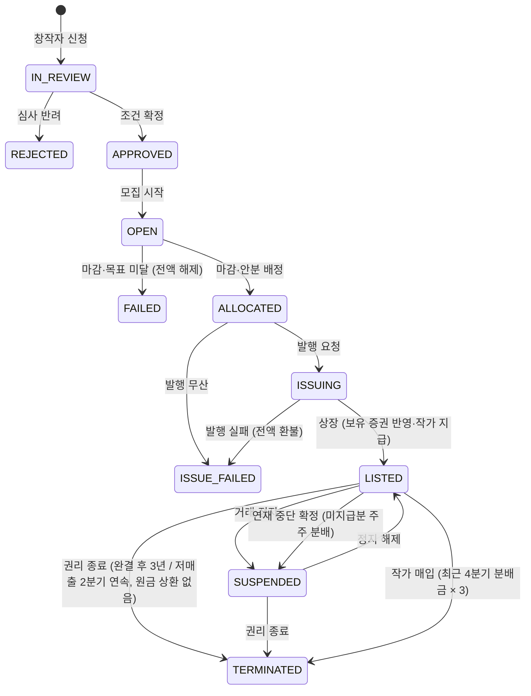
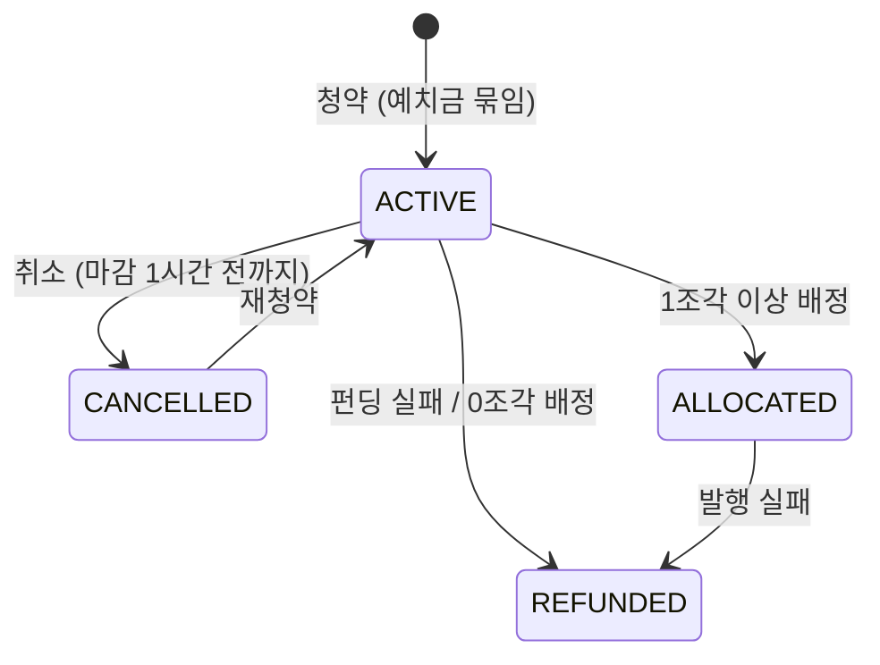
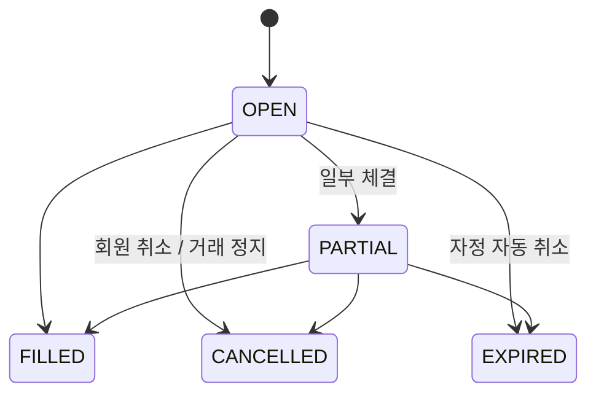

# DIBS ERD

> `python -m scripts.export_docs` 로 모델 코드에서 생성됩니다.

## 테이블 묶음

| 영역 | 테이블 | 비고 |
|---|---|---|
| 회원 | users, notifications | 역할: READER / CREATOR / ADMIN |
| 콘텐츠 | works, episodes, shorts, dibs, episode_unlocks | 발행 전 전 회차 무료, 상장 후 운영자가 유료 지정 |
| 이용 데이터 | content_events | 데이터 분석 팀과 공유하는 원천 로그 (docs/EVENTS.md) |
| 원장 | accounts, journals, postings, withdrawal_requests | 복식부기, append-only. 코인·예치금 계정 분리 |
| 펀딩 | fundings, reward_tiers, subscriptions, payout_schedules | 펀딩 = 조각 청약, 상장 후 fundings 가 종목 역할 |
| 발행 | issuances | 제휴 증권사 발행 단계 |
| 마켓 | holdings, orders, trades | 지정가 상대매매 (모의) |
| 배당 | revenue_records, dividend_runs, dividend_payments | 분기 배당 (나눠지는 재원 + 전액 주주 재원) |
| 커뮤니티 | posts, post_reports, user_blocks, notices | 댓글·게시판·팬아트·주주 게시판·신고·공지 |

## 상태 흐름

### 펀딩 (fundings.status)

### 청약 (subscriptions.status)

### 주문 (orders.status)

## 돈의 흐름 (원장 분개)

| 이벤트 | 출금 계정 (−) | 입금 계정 (+) |
|---|---|---|
| 코인 충전 | SYS_PG | COIN |
| 유료 미리보기 구매 (4화부터, 공개 21일 후 무료) | COIN | SYS_COIN_REVENUE |
| 예치금 입금 | SYS_BANK | DEPOSIT |
| 청약 | DEPOSIT | DEPOSIT_LOCKED |
| 마감·배정 | DEPOSIT_LOCKED | SYS_FUNDING_ESCROW (배정분) + DEPOSIT (초과분 환불) |
| 펀딩 실패 | DEPOSIT_LOCKED | DEPOSIT |
| 상장 정산 | SYS_FUNDING_ESCROW | SYS_CREATOR_PAYABLE 80% · SYS_ISSUANCE_COST 12% · SYS_PLATFORM_REVENUE 8% |
| 작가 지급 (상장 40% · 마일스톤 30% · 30%) | SYS_CREATOR_PAYABLE | 작가 DEPOSIT |
| 연재 중단 분배 | SYS_CREATOR_PAYABLE (미지급분) | 주주 DEPOSIT (보유 비율) |
| 매수 주문 | DEPOSIT | DEPOSIT_LOCKED (금액 + 수수료) |
| 체결 | 매수자 DEPOSIT_LOCKED | 매도자 DEPOSIT (− 매도 수수료) · SYS_BROKER_FEE (매수·매도 수수료 0.015%, 거래소·증권사 몫) |
| 배당 지급 | SYS_ROYALTY_POOL | 주주 DEPOSIT (세후) · SYS_TAX_WITHHOLDING · 작가 DEPOSIT · SYS_PLATFORM_REVENUE (회수 전 45·30·25 → 회수 후 35·40·25) |
| 작가 매입 | 작가 DEPOSIT | 주주 DEPOSIT (보유 비율) |

코인 → 예치금 방향의 분개는 원장 계층에서 거부됩니다 (`COIN_TO_DEPOSIT_FORBIDDEN`).

## 전체 ERD

```mermaid
erDiagram
    accounts {
        integer id PK
        enum kind
        integer owner_id FK
        enum mode
    }
    content_events {
        integer id PK
        integer user_id FK
        string anon_id
        string session_id
        enum event_type
        integer work_id FK
        integer episode_id FK
        integer short_id FK
        integer funding_id FK
        float progress
        datetime occurred_at
        datetime received_at
        json props
    }
    dibs {
        integer id PK
        integer user_id FK
        integer work_id FK
        datetime created_at
    }
    dividend_payments {
        integer id PK
        integer run_id FK
        integer user_id FK
        integer units
        bigint gross
        bigint tax
        bigint net
    }
    dividend_runs {
        integer id PK
        integer funding_id FK
        string period
        date record_date
        date pay_date
        bigint net_revenue
        string phase
        boolean recouped_now
        bigint holder_pool
        bigint creator_amount
        bigint platform_amount
        bigint residual
        integer total_units
        double per_unit_gross
        enum status
        integer journal_id FK
        datetime created_at
    }
    episode_unlocks {
        integer id PK
        integer user_id FK
        integer episode_id FK
        integer work_id FK
        integer price_coin
        integer journal_id FK
        integer funding_id FK
        datetime unlocked_at
    }
    episodes {
        integer id PK
        integer work_id FK
        integer no
        string title
        string content_url
        boolean paid_preview
        integer price_coin
        datetime free_unlock_at
        datetime created_at
        datetime updated_at
    }
    fundings {
        integer id PK
        integer work_id FK
        enum status
        enum mode
        enum security_type
        integer unit_price
        integer target_units
        integer max_units_per_user
        datetime open_at
        datetime close_at
        text use_of_funds
        text risk_note
        integer creator_bps
        integer issuance_cost_bps
        integer platform_fee_bps
        integer royalty_platform_bps
        integer royalty_creator_bps
        integer royalty_holder_bps
        integer royalty_platform_after_bps
        integer royalty_creator_after_bps
        integer royalty_holder_after_bps
        string recouped_period
        string allocation_strategy
        json allocation_params
        string offering_round
        integer exclusive_months
        datetime exclusive_until
        integer external_share_bps
        datetime completed_at
        datetime terminated_at
        string termination_reason
        boolean buyback_enabled
        datetime discontinued_at
        integer reference_price
        integer last_price
        datetime listed_at
        text review_note
        datetime created_at
        datetime updated_at
    }
    holdings {
        integer id PK
        integer user_id FK
        integer funding_id FK
        enum mode
        integer units
        integer locked_units
        integer avg_price
        datetime created_at
        datetime updated_at
    }
    issuances {
        integer id PK
        integer funding_id FK
        enum step
        string broker_name
        string security_code
        string trustee
        date listing_date
        text failed_reason
        json history
        datetime created_at
        datetime updated_at
    }
    journals {
        integer id PK
        string kind
        string ref_type
        integer ref_id
        string memo
        enum mode
        datetime created_at
    }
    notices {
        integer id PK
        string title
        text body
        string category
        integer funding_id FK
        boolean is_pinned
        datetime created_at
        datetime updated_at
    }
    notifications {
        integer id PK
        integer user_id FK
        string type
        string title
        text body
        string ref_type
        integer ref_id
        boolean is_read
        datetime created_at
    }
    orders {
        integer id PK
        integer user_id FK
        integer funding_id FK
        enum mode
        enum side
        integer price
        integer units
        integer remaining_units
        enum status
        integer fee_ppm
        bigint locked_amount
        date trade_date
        datetime created_at
        datetime updated_at
    }
    payout_schedules {
        integer id PK
        integer funding_id FK
        integer seq
        integer bps
        enum trigger
        string milestone_note
        enum status
        bigint amount
        integer paid_journal_id FK
    }
    post_reports {
        integer id PK
        integer post_id FK
        integer reporter_id FK
        string reason
        datetime created_at
    }
    postings {
        integer id PK
        integer journal_id FK
        integer account_id FK
        bigint amount
    }
    posts {
        integer id PK
        enum kind
        integer work_id FK
        integer episode_id FK
        integer short_id FK
        integer parent_id FK
        integer author_id FK
        text body
        string image_url
        boolean is_hidden
        boolean is_deleted
        datetime created_at
        datetime updated_at
    }
    revenue_records {
        integer id PK
        integer funding_id FK
        string period
        enum source
        bigint gross
        bigint deductions
        bigint net
        text note
        string evidence_url
        datetime created_at
    }
    reward_tiers {
        integer id PK
        integer funding_id FK
        string title
        text description
        integer min_units
        integer limited_qty
        boolean requires_shipping
    }
    shorts {
        integer id PK
        integer work_id FK
        string title
        string video_url
        integer duration_sec
        datetime created_at
        datetime updated_at
    }
    subscriptions {
        integer id PK
        integer funding_id FK
        integer user_id FK
        integer units
        enum status
        integer allocated_units
        integer requested_tier_id FK
        integer assigned_tier_id FK
        json shipping
        datetime first_subscribed_at
        string tracking_carrier
        string tracking_no
        datetime shipped_at
        json consents
        datetime created_at
        datetime updated_at
    }
    trades {
        integer id PK
        integer funding_id FK
        enum mode
        integer price
        integer units
        integer buy_order_id FK
        integer sell_order_id FK
        integer buyer_id FK
        integer seller_id FK
        bigint buy_fee
        bigint sell_fee
        integer journal_id FK
        datetime created_at
    }
    user_blocks {
        integer id PK
        integer user_id FK
        integer blocked_id FK
        datetime created_at
    }
    users {
        integer id PK
        string email
        string nickname
        enum role
        enum investor_type
        boolean kyc_verified
        text bio
        string avatar_url
        string risk_level
        datetime risk_checked_at
        string broker_name
        string broker_account_masked
        datetime created_at
        datetime updated_at
    }
    withdrawal_requests {
        integer id PK
        integer user_id FK
        bigint amount
        enum mode
        string status
        datetime created_at
        datetime decided_at
    }
    works {
        integer id PK
        integer creator_id FK
        string title
        enum type
        string genre
        text synopsis
        string cover_url
        enum status
        boolean rights_declared
        text prior_contract_note
        text review_note
        datetime created_at
        datetime updated_at
    }
    accounts ||--o{ postings : "account_id"
    dividend_runs ||--o{ dividend_payments : "run_id"
    episodes ||--o{ content_events : "episode_id"
    episodes ||--o{ episode_unlocks : "episode_id"
    episodes ||--o{ posts : "episode_id"
    fundings ||--o{ content_events : "funding_id"
    fundings ||--o{ dividend_runs : "funding_id"
    fundings ||--o{ episode_unlocks : "funding_id"
    fundings ||--o{ holdings : "funding_id"
    fundings ||--o{ issuances : "funding_id"
    fundings ||--o{ notices : "funding_id"
    fundings ||--o{ orders : "funding_id"
    fundings ||--o{ payout_schedules : "funding_id"
    fundings ||--o{ revenue_records : "funding_id"
    fundings ||--o{ reward_tiers : "funding_id"
    fundings ||--o{ subscriptions : "funding_id"
    fundings ||--o{ trades : "funding_id"
    journals ||--o{ dividend_runs : "journal_id"
    journals ||--o{ episode_unlocks : "journal_id"
    journals ||--o{ payout_schedules : "paid_journal_id"
    journals ||--o{ postings : "journal_id"
    journals ||--o{ trades : "journal_id"
    orders ||--o{ trades : "buy_order_id"
    orders ||--o{ trades : "sell_order_id"
    posts ||--o{ post_reports : "post_id"
    posts ||--o{ posts : "parent_id"
    reward_tiers ||--o{ subscriptions : "assigned_tier_id"
    reward_tiers ||--o{ subscriptions : "requested_tier_id"
    shorts ||--o{ content_events : "short_id"
    shorts ||--o{ posts : "short_id"
    users ||--o{ accounts : "owner_id"
    users ||--o{ content_events : "user_id"
    users ||--o{ dibs : "user_id"
    users ||--o{ dividend_payments : "user_id"
    users ||--o{ episode_unlocks : "user_id"
    users ||--o{ holdings : "user_id"
    users ||--o{ notifications : "user_id"
    users ||--o{ orders : "user_id"
    users ||--o{ post_reports : "reporter_id"
    users ||--o{ posts : "author_id"
    users ||--o{ subscriptions : "user_id"
    users ||--o{ trades : "buyer_id"
    users ||--o{ trades : "seller_id"
    users ||--o{ user_blocks : "blocked_id"
    users ||--o{ user_blocks : "user_id"
    users ||--o{ withdrawal_requests : "user_id"
    users ||--o{ works : "creator_id"
    works ||--o{ content_events : "work_id"
    works ||--o{ dibs : "work_id"
    works ||--o{ episode_unlocks : "work_id"
    works ||--o{ episodes : "work_id"
    works ||--o{ fundings : "work_id"
    works ||--o{ posts : "work_id"
    works ||--o{ shorts : "work_id"
```

